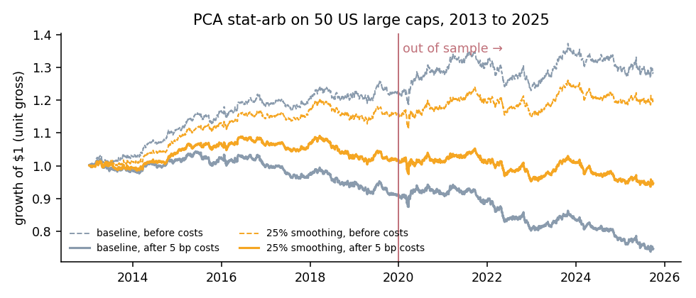
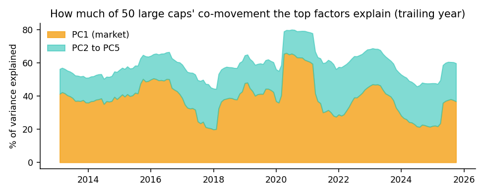
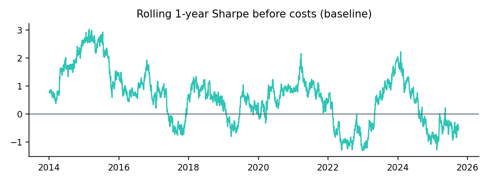

# PCA statistical arbitrage on US large caps

A from-scratch, walk-forward replication of the classic Avellaneda & Lee (2010) strategy:
extract risk factors with PCA, strip them out of each stock's returns, and trade the
mean reversion of what is left, fully hedged against the factors. Tested on 50 US large
caps from 2013 to 2025 with transaction costs, a no-look-ahead test suite and an honest
out-of-sample split.

**Short version:** the method works as designed. The book is market-neutral (beta 0.03),
and it has a real edge before costs (Sharpe 0.48, 0.84 in 2013 to 2019). But the edge is
thin, it decays after 2020, and at 5 bp per trade it does not survive costs in large caps.
Breakeven is about 2.4 bp. That result, and why, is the point of this repository.



## How it works

Every day, using only data available at that day's close:

1. **Factors.** Standardise the last 252 days of returns and take the top 5 eigenvectors
   of their correlation matrix. Dividing each eigenvector by the stocks' volatilities gives
   tradable **eigenportfolios**; their returns are the factor returns.
2. **Residuals.** Regress each stock's last 60 days of returns on the 5 factor returns.
   The residual is the part of the move the factors do not explain.
3. **Mean reversion.** Fit the cumulative residual as an Ornstein–Uhlenbeck process (as an
   AR(1)) to get its speed of mean reversion κ, equilibrium level and equilibrium volatility.
   Only stocks that revert within about 30 days (κ > 252/30) are tradable.
4. **Signal.** The **s-score** measures how far a stock sits from equilibrium, in standard
   deviations. Open a long when s < −1.25, a short when s > 1.25; close longs above −0.50
   and shorts below 0.75.
5. **Hedge.** Compute the stock book's exposure to every factor and offset it with the
   eigenportfolios, then scale to $1 of gross exposure.
6. **Costs.** Charge 5 bp one way on every dollar traded.

| Module | Role |
| --- | --- |
| `pcaarb/data.py` | Price download and cache, 50-stock universe, SPY benchmark |
| `pcaarb/factors.py` | PCA factors and eigenportfolios |
| `pcaarb/signals.py` | Residual regression, OU fit, s-scores, trading rules |
| `pcaarb/backtest.py` | Walk-forward backtest, factor hedge, turnover controls, metrics |
| `scripts/turnover_study.py` | Out-of-sample comparison of turnover controls |
| `scripts/report.py` | Charts and summary numbers in `docs/` |
| `tests/` | No-look-ahead, return dating, OU fit, trading rules, factor properties |

## Results (Jan 2013 to Sep 2025, $1 gross)

| | Before costs | After 5 bp costs |
| --- | --- | --- |
| Annual return | 2.1% | −2.2% |
| Annual volatility | 4.3% | 4.3% |
| Sharpe | **0.48** | −0.52 |
| Max drawdown | −8.9% | −29.4% |
| Beta to S&P 500 | 0.03 | 0.03 |

About 10 longs and 8 shorts are open on a typical day, and the book turns over 34% of its
gross exposure daily, roughly 85 times a year. That is why the edge cannot pay for 5 bp.

### What the factors look like



- **PC1 is the market.** It explains 20% of the co-movement in calm markets and 66% in the
  2020 crash, when correlations jump.
- **PC2 changes with the regime:** energy against consumer growth in 2015, cyclicals
  against defensives in March 2020, mega-cap tech against consumer staples in 2025.

### Turnover study, with an honest out-of-sample split

Four turnover controls were fixed in advance. The choice uses **only 2013 to 2019**, and the
2020 to 2025 numbers are shown for all of them (`docs/turnover_study.csv`).

| Candidate | Daily turnover | Net Sharpe 2013–19 (choose) | Net Sharpe 2020–25 (test) |
| --- | --- | --- | --- |
| A. Baseline | 34% | −0.35 | −0.67 |
| **B. Trade 25% toward target (chosen)** | 15% | **+0.10** | −0.28 |
| C. Wider entry bands (\|s\| > 2) | 34% | −0.31 | −0.01 |
| D. Weekly rebalancing | 16% | 0.00 | −0.55 |

Smoothing halves turnover and is the only control that is positive in the development
period, so it is the choice. Out of sample it still loses money after costs. Candidate C
looks best on 2020 to 2025, but picking it after seeing those years would be look-ahead
bias, so it is reported, not chosen.



The raw edge itself fades: gross Sharpe falls from 0.84 (2013 to 2019) to 0.19 (2020 to 2025),
consistent with the crowding and decay of residual-reversal strategies in liquid large caps.

## Limitations

- **Survivorship bias.** The universe is today's large caps, so stocks that failed or were
  delisted are missing. The strategy is market-neutral, which limits the effect but does not
  remove it.
- **Costs are a flat 5 bp.** Real costs vary with liquidity, volatility and trade size.
- **Close-to-close execution.** Signals and fills both use closing prices.
- **No borrow costs** for the short side.

## Ideas to take it further

- Volume-weighted returns in the residual model (the "trading time" variant from the paper)
- A broader, cheaper-to-trade-around universe such as mid caps, where residuals are less crowded
- Cost-aware position sizing: trade only when the expected reversion exceeds the cost

## Run it

```bash
python3 -m venv .venv && source .venv/bin/activate
pip install -r requirements.txt
pytest -q                                   # 11 tests
PYTHONPATH=. python scripts/turnover_study.py
PYTHONPATH=. python scripts/report.py       # writes charts to docs/
```

The first run downloads prices from Yahoo Finance into `data/` (not committed).

## Reference

Avellaneda, M. and Lee, J.-H. (2010). *Statistical arbitrage in the U.S. equities market.*
Quantitative Finance, 10(7), 761–782.

---

Yuvraj Chawla · M.S. Quantitative Finance, Northeastern University · [yuvrajchawla.si](https://yuvrajchawla.si)
